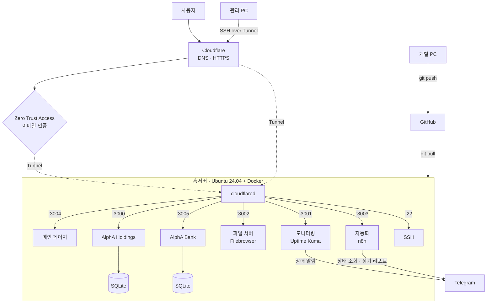

# alpha-infra
AlphA Inc. 개인 홈서버 인프라

개인 프로젝트를 운영하려고 쓰지 않던 노트북에 구축한 홈서버입니다.
Ubuntu 서버에서 서비스를 Docker 컨테이너로 운영하고, Cloudflare Tunnel로 공유기 포트를 하나도 열지 않은 채 외부에 공개합니다.

## 구성도


## 스택
| 구분 | 사용 기술 |
|---|---|
| 하드웨어 | LG gram 노트북 (유휴 장비 재사용) |
| OS | Ubuntu 24.04 |
| 컨테이너 | Docker, Docker Compose |
| 외부 공개 | Cloudflare Tunnel (cloudflared) |
| 접근 제어 | Cloudflare Zero Trust Access (이메일 OTP), 앱 자체 로그인 |
| 모니터링 · 알림 | Uptime Kuma, n8n, Telegram |
| 애플리케이션 | Next.js, TypeScript, Prisma, SQLite |

## 운영 중인 서비스
| 도메인 | 서비스 | 내부 주소 | 접근 |
|---|---|---|---|
| alphaintlgroup.com | 메인 페이지 | localhost:3004 | 공개 |
| holdings.alphaintlgroup.com | AlphA Holdings (자산관리) | localhost:3000 | 이메일 인증 |
| bank.alphaintlgroup.com | AlphA Bank (재무관리: 예산·자산) | localhost:3005 | 이메일 인증 |
| cloud.alphaintlgroup.com | Filebrowser (파일 서버) | localhost:3002 | 앱 자체 로그인 (ID/PW) |
| auto.alphaintlgroup.com | n8n (자동화) | localhost:3003 | 앱 자체 로그인 (ID/PW) |
| radar.alphaintlgroup.com | Uptime Kuma (모니터링) | localhost:3001 | 앱 자체 로그인 (ID/PW) |
| terminal.alphaintlgroup.com | SSH | localhost:22 | SSH 로그인 |

## 배포
```
개발 PC: git push
서버:    git pull → docker compose up -d --build
```
DB 구조가 바뀌는 배포는 순서를 지킵니다: **이미지 빌드 확인 → 컨테이너 정지 → DB 백업 → 스키마 반영 → 마이그레이션 → 기동**.
코드를 되돌릴 때는 DB도 백업본으로 함께 되돌립니다. (예: [AlphA-Bank 배포 절차서](https://github.com/alpha-1nc/AlphA-Bank/blob/main/docs/DEPLOY.md))

## 모니터링과 알림
- **Uptime Kuma**: 각 서비스 주소를 주기적으로 확인하고, 응답이 없으면 텔레그램으로 알림을 보냅니다.
- **n8n**: 텔레그램에서 `/서버`, `/도커` 명령을 보내면 서버 부하·메모리와 컨테이너 상태를 바로 받아봅니다. 주간·월간 정기 리포트(관심 종목 등락률·지표)도 보냅니다.
- **최소 권한**: 처음에는 n8n 컨테이너에 docker.sock을 마운트해 Docker 관리 권한이 열려 있었습니다. 이를 제거하고, 호스트 cron이 1분마다 컨테이너 상태를 파일로 기록하면 n8n은 그 파일만 읽기 전용(`:ro`)으로 마운트해 읽도록 바꿨습니다.

## 기술 선택 이유
### 왜 Cloudflare Tunnel인가
가정용 회선의 공인 IP는 통신사가 임대해주는 것이라 재부팅하거나 일정 기간이 지나면 바뀔 수 있습니다. 포트포워딩 방식을 쓰면 바뀌는 IP를 계속 추적하는 DDNS가 필요합니다.
터널은 IP 대신 터널 ID로 연결되기 때문에 IP가 바뀌어도 DNS 설정을 건드릴 필요가 없습니다.
또 서버의 cloudflared가 Cloudflare 쪽으로 먼저 연결(아웃바운드)을 맺고 요청이 그 연결을 타고 들어오기 때문에, 외부에서 서버로 직접 들어오는 경로가 없습니다. 인바운드 포트를 열지 않아도 되어 보안상 더 안전합니다.
다만 모든 트래픽이 Cloudflare를 거치므로 Cloudflare 장애 시 전체 서비스가 영향을 받습니다. 개인 프로젝트 규모에서는 감수할 수 있다고 판단했습니다.

### 왜 Zero Trust Access인가
Holdings와 Bank에는 개인 자산 정보가 있지만 앱 자체에는 로그인 기능이 없습니다. 앱마다 로그인을 만드는 대신 Cloudflare Access로 앞단에서 막아, 등록된 이메일로 받은 인증번호를 입력해야만 서비스에 도달하도록 했습니다.

### 왜 SQLite인가
사용자가 사실상 1명이고 동시 쓰기가 거의 없는 서비스라, 별도 DB 서버 컨테이너를 띄울 필요가 없다고 판단했습니다. DB가 파일 하나라 백업이 파일 복사로 끝나는 것도 장점입니다.
사용자나 동시 쓰기가 늘어나면 PostgreSQL 같은 서버형 DB로 옮기는 것을 고려합니다.

### 왜 서비스마다 컨테이너를 나눴나
서비스마다 Node 버전과 의존성이 달라 한 환경에 함께 두면 충돌할 수 있습니다. 컨테이너로 나누면 하나를 재빌드하거나 문제가 생겨도 다른 서비스에 영향이 없고, compose 파일만 있으면 다른 서버에서도 같은 환경을 다시 만들 수 있습니다.

## 트러블슈팅
### 1. 컨테이너를 재빌드하면 DB 데이터가 사라짐
- **증상**: 기능을 수정하고 `docker compose up --build`로 재배포하자 입력해둔 데이터가 초기화됨
- **원인**: SQLite 파일이 컨테이너 내부 경로에 저장되고 있어, 컨테이너가 새로 만들어질 때 함께 사라짐
- **해결**: DB 폴더를 호스트 디렉터리에 바인드 마운트(`./prisma:/app/prisma`)해 컨테이너와 데이터의 수명을 분리
- **이후**: DB를 건드리는 작업 전에는 반드시 DB 파일을 백업하는 것을 원칙으로 함

### 2. 컨테이너 안에서 DB 마이그레이션 스크립트 실행 실패
- **증상**: AlphA Bank 컨테이너 안에서 마이그레이션 스크립트를 실행하자 `fcntl64` 심볼 오류로 실패
- **원인**: 이미지가 `node:20-alpine`(musl libc) 기반인데, 스크립트가 쓰는 `@libsql/client` 네이티브 모듈은 glibc를 기준으로 빌드되어 있음
- **해결**: 마이그레이션 스크립트는 컨테이너 대신 호스트(또는 debian 기반 일회성 컨테이너)에서 DB 파일 경로를 직접 지정해 실행하도록 배포 절차를 바꿈

### 3. 자동화 도구에 열려 있던 Docker 관리 권한
- **증상**: n8n의 `/도커` 명령이 `EACCES /var/run/docker.sock` 오류로 실패
- **원인**: 컨테이너 상태를 조회하려고 docker.sock을 마운트해 두었는데, 이는 사실상 호스트 전체에 대한 관리 권한을 자동화 도구에 준 상태였음
- **해결**: docker.sock 마운트를 제거하고, 호스트 cron(`docker ps` → 상태 파일)과 읽기 전용 마운트(`/home/alpha/n8n-shared:/shared:ro`)로 필요한 정보만 전달

## 개선 예정
- 컨테이너 포트를 `127.0.0.1`에만 바인딩해 같은 공유기의 다른 기기에서도 직접 접근하지 못하게 제한
- DB 백업을 수동에서 cron 기반 자동 백업으로 전환
