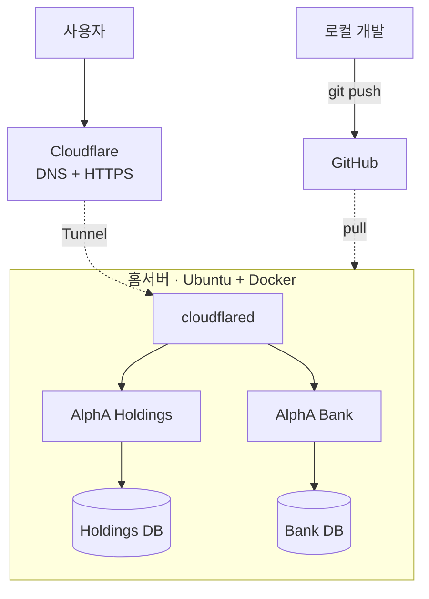

# alpha-infra
# AlphA Inc. 개인 인프라

개인 프로젝트 운영을 위해 구축한 홈서버 인프라.
Ubuntu 서버에 Docker로 서비스를 띄우고 Cloudflare Tunnel로 외부에 공개한다.

## 구성도

## 스택
- OS: Ubuntu 22.04 (홈서버)
- 컨테이너: Docker, docker compose
- 외부 노출: Cloudflare Tunnel
- 애플리케이션: Next.js, TypeScript, Prisma, SQLite

## 운영 중인 서비스
| 서비스 | 도메인 | 설명 |
|---|---|---|
| AlphA Holdings | holdings.alphaintlgroup.com | 투자 포트폴리오 관리 |
| AlphA Bank | bank.alphaintlgroup.com | 자산 관리 |

## 배포
git push → 서버에서 pull → `docker compose up --build`

## 기술 선택 이유
### 왜 Cloudflare Tunnel인가
가정용 회선의 공인 IP는 통신사가 임대해주는 것이기 때문에 주기적으로  IP가 바뀌어서 일정 기간이 지나거나 재부팅하면 변경될 수 있다.
그래서 포트포워딩 방식을 사용하면 IP를 적어놔야 하기 때문에 계속 IP를 추적해주는 DDNS를 사용해야 하는 번거로움이 있다.
하지만 터널을 사용하면 IP를 적어놓을 필요 없이 터널ID를 적어놔서 DNS 설정을 건드릴 필요가 없다.
또한 공유기는 기본적으로 아웃바운드만 허용하는데 홈서버에 설치한 cloudflared 데몬이 Cloudflare 엣지로 연결되어 요청이 그 연결을 타고 들어오기 때문에 외부에서 서버로 직접 들어올 경로 자체가 없다. 따라서 인바운드 포트를 열지 않아도 되서 보안적으로 더 낫다.
다만 모든 트래픽이 Cloudflare를 경유하기 때문에 Cloudflare 서비스 장애 시 전체 서비스가 영향을 받겠지만 세계 각지의 여러 기업에서 사용하는 서비스이니 만큼 개인 프로젝트에서는 지장이 없다고 판단하여 선택했다.

### 왜 SQLite인가
(직접 써봐)

### 왜 컨테이너로 분리했나
(직접 써봐)

## 트러블슈팅
(겪었던 문제 1~2개. 증상 → 원인 → 해결)
