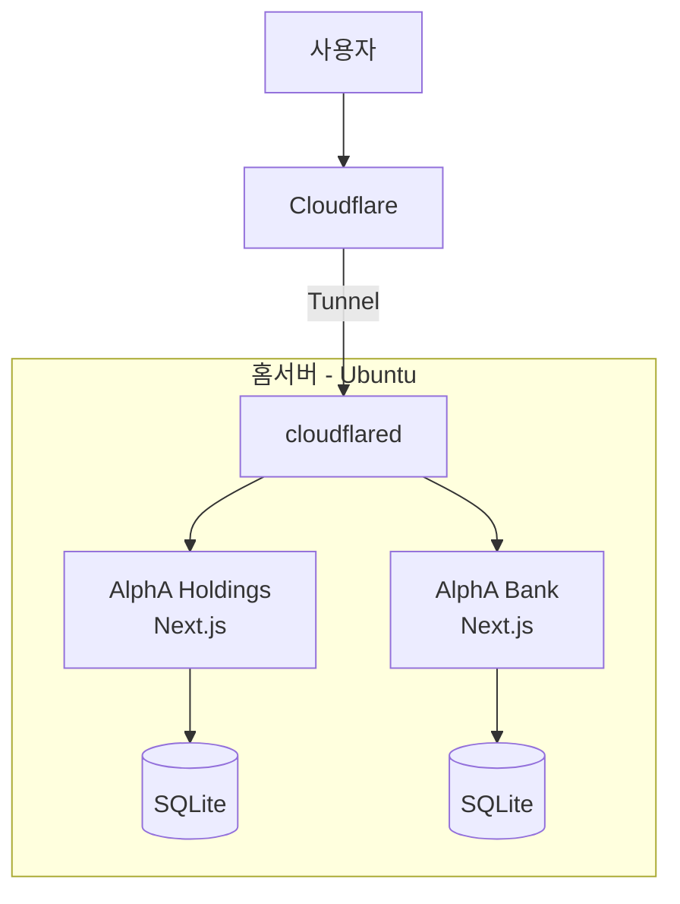

# alpha-infra
# AlphA Inc. 개인 인프라

개인 프로젝트 운영을 위해 구축한 홈서버 인프라.
Ubuntu 서버에 Docker로 서비스를 띄우고 Cloudflare Tunnel로 외부에 공개한다.

## 구성도
[여기 그림]

## 스택
- OS: Ubuntu 22.04 (홈서버)
- 컨테이너: Docker, docker compose
- 외부 노출: Cloudflare Tunnel
- 애플리케이션: Next.js, TypeScript, Prisma, SQLite

## 운영 중인 서비스
| 서비스 | 도메인 | 설명 |
|---|---|---|
| AlphA Holdings | holdings.alphaintlgroup.com | 포트폴리오 관리 |
| AlphA Bank | (도메인) | 월별 예산 관리 |

## 배포
git push → 서버에서 pull → `docker compose up --build`

## 기술 선택 이유
### 왜 Cloudflare Tunnel인가
가정용 회선이라 공인 IP가 고정이 아니고 포트포워딩을 열고 싶지 않았다.
터널은 서버가 아웃바운드로 연결을 맺기 때문에 인바운드 포트를 열지 않아도 되고,
공유기 설정 없이 도메인 연결과 HTTPS가 한 번에 해결된다.

### 왜 SQLite인가
(직접 써봐)

### 왜 컨테이너로 분리했나
(직접 써봐)

## 트러블슈팅
(겪었던 문제 1~2개. 증상 → 원인 → 해결)
